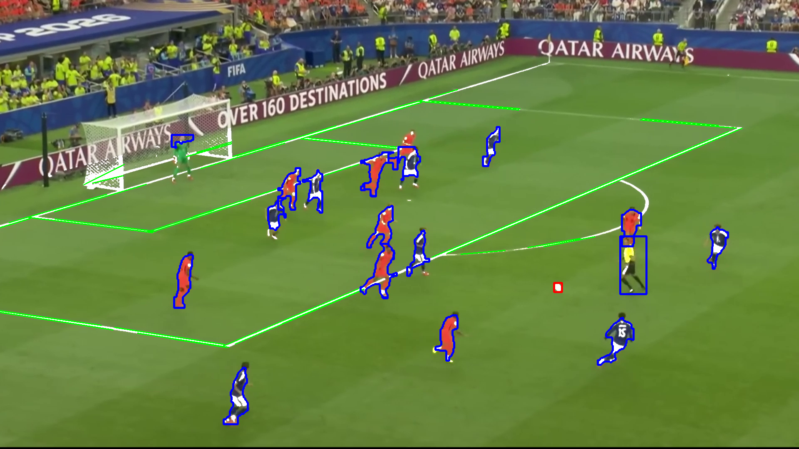

# El Ojo del Árbitro Digital

Trabajo práctico grupal de Visión Computacional de la Universidad de Palermo. Analiza un fotograma aleatorio de un partido de fútbol para resaltar jugadores en azul, la pelota en rojo y las líneas de la cancha en verde.

Compara una versión clásica con OpenCV (segmentación HSV, morfología, contornos, Canny y Hough) con una versión que incorpora YOLOv8 para detectar personas y pelotas.

## Uso

Instalá las dependencias y abrí Jupyter desde la carpeta del proyecto:

```bash
python -m pip install jupyter opencv-python numpy matplotlib ultralytics
jupyter notebook ojo_arbitro_digital.ipynb
```

Ejecutá las celdas en orden. El video incluido está configurado por defecto; podés cambiar `VIDEO_PATH` y los parámetros en el notebook. La Parte A usa técnicas clásicas y la Parte B agrega YOLO; puede ejecutarse en CPU o en una GPU compatible.

## Archivos

- `ojo_arbitro_digital.ipynb`: desarrollo explicado y comparación de ambos métodos.
- `pipeline.ipynb`: implementación compacta con YOLO.
- `VideoHolandaJapon_Contraste.mp4`: video de prueba.
- `yolov8n.pt` y `yolov8s.pt`: pesos preentrenados de YOLOv8.
- `resultado_ojo_arbitro.png`: ejemplo de salida.

La detección depende de la iluminación, el zoom y la visibilidad de los objetos; la pelota puede no detectarse si es pequeña o está tapada.


